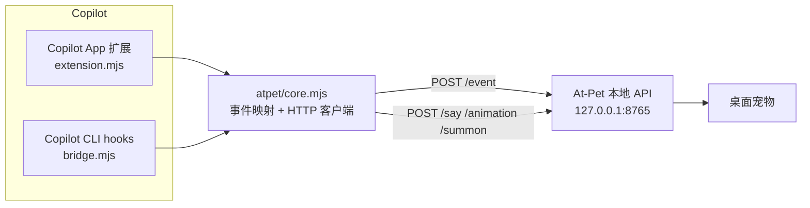

# GitHub Copilot × At-Pet 桥接插件

把 **GitHub Copilot** 的工作状态接到 [At-Pet](https://github.com/At-PetAdmin/At-Pet) 桌宠上：Copilot 在干活时桌宠思考，跑工具时桌宠忙碌，出错时桌宠垮掉，收工时会说话。

灵感来自 [Ni-ShuWu/copilot-desktop-pet](https://github.com/Ni-ShuWu/copilot-desktop-pet)（已停止维护的 Copilot App 桌宠扩展）和 [At-PetAdmin/At-Pet](https://github.com/At-PetAdmin/At-Pet)（Qt 桌宠本体 + 本地 HTTP API）。本项目只做桥接：**不修改 At-Pet，也不修改 Copilot**，两侧都通过各自公开的对外接口通信。



## 目录结构

| 路径 | 作用 |
| --- | --- |
| `atpet/core.mjs` | 共享核心：事件映射表 + At-Pet HTTP 客户端（纯函数，可单测） |
| `atpet/config.mjs` | 配置发现与合并（JSON 文件 + 环境变量） |
| `atpet/extension.mjs` | Copilot App 扩展入口（订阅会话事件，注册 `atpet_*` 工具） |
| `atpet/bridge.mjs` | Copilot CLI hook 桥接（stdin JSON → `/event`） |
| `atpet/atpet.config.example.json` | 配置样例 |
| `hooks/atpet.example.json` | CLI hooks 配置样例 |
| `scripts/install.mjs` | 安装器：`app` / `cli` / `doctor` |
| `tests/` | `node --test` 单元 + 集成测试 |
| `LICENSE` | MIT |

## 前置条件

- 已安装并运行 [At-Pet](https://github.com/At-PetAdmin/At-Pet)，其本地 API 默认监听 `http://127.0.0.1:8765`。
- Node.js ≥ 20。
- At-Pet 侧需启用 GitHub Copilot 监控（`githubcopilot` 是 At-Pet 内置 agent，默认开启）。

## 安装 A：Copilot App 扩展

```powershell
# 在本仓库根目录
node scripts/install.mjs app --repo D:\path\to\your\project
```

等价于把 `atpet/` 复制到 `D:\path\to\your\project\.github\extensions\atpet\`，之后在 Copilot App 里重载扩展即可。扩展会：

- 订阅会话事件并转成 At-Pet 事件；
- 注册 4 个工具供模型主动驱动桌宠（见下文）；
- 退出时补发一次 `session_end`，避免桌宠一直挂着「思考中」。

## 安装 B：Copilot CLI hooks

```powershell
node scripts/install.mjs cli --repo D:\path\to\your\project
```

这会把桥接脚本复制到 `%USERPROFILE%\.copilot\atpet-bridge\`，并生成
`D:\path\to\your\project\.github\hooks\atpet.json`（原文件会先备份为 `.bak`）。
想对**所有项目**生效，把生成的 `atpet.json` 复制到 `%USERPROFILE%\.copilot\hooks\atpet.json`。

生成的配置已写入脚本的绝对路径，不必再手动替换；若要手写配置，参考 `hooks/atpet.example.json`，把 `__ATPET_BRIDGE__` 换成实际目录即可。

Bridge 的铁律：**默认永远退出 0**（除非显式传 `--strict`），并在 hook 超时前返回，绝不阻塞 Copilot。

## 配置

优先级：`AT_PET_CONFIG` 指定的文件 → 扩展目录下 `atpet.config.json` →
`%APPDATA%\copilot-atpet\atpet.config.json` → `~/.copilot/atpet.config.json` → 默认值，
最后由环境变量覆盖。

| 键 | 环境变量 | 默认值 | 说明 |
| --- | --- | --- | --- |
| `url` | `AT_PET_URL` | `http://127.0.0.1:8765` | At-Pet 本地 API 地址 |
| `timeoutMs` | `AT_PET_TIMEOUT_MS` | `2000` | 单次请求超时（100–30000） |
| `agentApp` | `AT_PET_AGENT_APP` | `github-copilot` | At-Pet 中显示的 agent 名 |
| `sessionId` | `AT_PET_SESSION_ID` | 自动 | 固定会话 id；留空则用主机会话 id 或工作目录哈希 |
| `model` | `AT_PET_MODEL` | 空 | 显示在桌宠上的模型名 |
| `enabled` | `AT_PET_ENABLED` | `true` | 关掉后只做映射不发送 |
| `forwardMessages` | `AT_PET_FORWARD_MESSAGES` | `false` | 是否转发**错误文本**（见隐私说明） |
| `debug` | `AT_PET_DEBUG` | `false` | App 扩展里输出调试日志 |

## 事件映射

At-Pet 匹配事件名时会先去掉非字母数字字符，因此 `tool.execution_start` 和 `PreToolUse` 会归到同一类。

| Copilot App 事件 | Copilot CLI hook | 发给 At-Pet 的 `event` | 桌宠表现 |
| --- | --- | --- | --- |
| `session.start`、`user.message`、`assistant.turn_start`、`assistant.reasoning`、`assistant.message` | `sessionStart`、`userPromptSubmitted`、`SubagentStart` | `thinking` | 思考中 |
| `tool.execution_start` | `preToolUse` | `tool_start`（`message` = 工具名） | 工具动画 + 工具名 |
| `tool.execution_complete` | `postToolUse` | `tool_end` | 回到思考中 |
| `permission.requested` | `PermissionRequest` | `permission_requested` | 等待授权 |
| `session.idle`（正常结束） | `agentStop`、`Stop` | `done` | 完成动画 + 提示音 |
| `session.idle`（`aborted` / `reason: cancelled`） | — | `cancelled` | 被中断 |
| `session.error` | `errorOccurred`、`PostToolUseFailure` | `error` | 错误动画 |
| `session.end` | `sessionEnd` | `session_end` | 从桌宠会话列表移除 |

子 agent 事件会额外带上 `isSubagent: true` 和 `parentSessionId`，At-Pet 会把它们画成子会话，而不是抢占主会话。

## 模型可调用的工具（App 扩展）

| 工具 | 参数 | 作用 |
| --- | --- | --- |
| `atpet_say` | `text`、`durationSec?` | 让桌宠冒泡说话 |
| `atpet_animation` | `name` | 切换动画（如 `thinking`、`review`、`error`、`auto`） |
| `atpet_summon` | `all?`、`petId?` | 召唤 / 切换桌宠 |
| `atpet_status` | — | 读取当前动画、会话数 |

At-Pet 没启动时这些工具返回失败结果而不是抛错，模型可以继续正常工作。

## 隐私说明

默认**只发结构化字段**：会话 id、事件名、工具名、模型名、子 agent 标记。

以下内容不会离开 Copilot 进程：

- 用户提示词（prompt）
- 工具参数（命令、文件路径、diff 等）
- 工具输出与模型回复正文

唯一例外是错误文本：即使 `forwardMessages: true`，也只转发 `session.error` / `errorOccurred` 这类事件的错误消息，且截断到 180 字符。所有请求只发往 `url` 指向的本机地址（默认 `127.0.0.1`），没有任何云端上报。

## 已对接验证

针对 At-Pet **1.3.0** 实机验证过（`GET /health`、`GET /state`、`POST /event`、`POST /say` 均返回 `202 {"accepted":true}`）：

- `agentApp: "github-copilot"` 在 At-Pet 侧被归一化为内置 agent **GitHub Copilot**（不是新增一个陌生 agent）；
- `thinking` / `tool_start` 事件会让该会话出现在 `/state` 的 `sessions` 中，`tool_start` 附带的工具名会显示在桌宠气泡里；
- `session_end` 会把会话从列表移除，桌宠不会一直停留在「思考中」；
- `/state` 结构：`{ app, version, pets: [{ id, name, animation }], sessions: [{ sessionId, agentApp, animation, isSubagent, model, source, updatedAt }], agentSources, supportedAgentApps }`，`atpet_status` 输出的就是它的精简版。

## 故障排查

```powershell
node scripts/install.mjs doctor --repo D:\path\to\your\project
```

它会打印配置文件、URL、At-Pet 可达性，以及 App 扩展 / hooks 是否已安装。

| 现象 | 处理 |
| --- | --- |
| 桌宠完全没反应 | `doctor` 看 At-Pet 是否可达；`curl http://127.0.0.1:8765/health` |
| At-Pet 端口不是 8765 | 设 `AT_PET_URL`，或写进配置文件 |
| 桌宠显示成别的 agent | 改 `agentApp`，At-Pet 会按名字匹配内置 agent |
| 桌宠一直「思考中」不动 | 可能没收到 `done`：确认 `agentStop` / `sessionEnd` hook 已注册 |
| 手动验证映射 | `node atpet/bridge.mjs preToolUse --print < payload.json` |
| 想看 CLI 实际传了什么 | `node atpet/bridge.mjs preToolUse --capture payloads.jsonl` |

## 开发

```powershell
npm test                     # node --test：映射、配置、客户端容错 + 真实 spawn bridge 的集成测试
node atpet/bridge.mjs --help
```

## 许可

MIT
